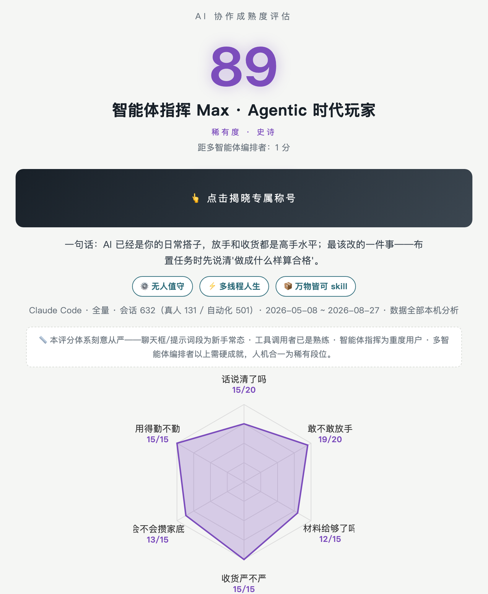

# AI Collaboration Maturity Assessment (ai-maturity)

[](https://merx.help/shield)

**English** · [中文](#ai-协作成熟度评估ai-maturity)

**It doesn't grade your AI. It grades how well you work with it.**

An Agent Skill that reads your complete local AI session history (not just the last few days of short-term memory), scores your human–AI collaboration across six dimensions, and renders an interactive HTML report with a rank, a personal title, and concrete next steps.

> You might be a "Prompt Engineer Pro" — or an "Agent Commander Max". Click to reveal.

<p align="center"></p>

## Why

Every benchmark out there measures the AI — leaderboards, evals, capability scores. Nobody measures **the human**. Yet the real gap is rarely "is the model good enough"; it's "am I using it well":

- Do you define what "done" means when you hand over a task?
- Is your AI an autonomous coworker, or a button you press step by step?
- Has your repetitive work become one-command automation?

The answers are already sitting in your own session logs. This skill reads them, scores them, and tells you what to fix next.

## Three design principles

1. **Data never leaves your machine.** All analysis runs locally; the report is a self-contained HTML with zero external links. You decide who sees it.
2. **Evidence before scores.** Every point cites your real sessions as evidence; counting is done by a deterministic script, and the model is not allowed to invent numbers.
3. **Reverse-engineering welcome.** This is a behavioral assessment, not an exam — the only way to game it is to actually build the habits: write acceptance criteria, feed real context, automate, parallelize. To cheat, you must genuinely get better.

## Ranks

| Rank | Score | In one line |
|---|---|---|
| ❄️ Cold Start | <15 real sessions | Not rated yet — go use it first |
| Chatbox Player → Pro → Max | 0–39 | Still in Q&A mode |
| Prompt Engineer → Pro → Max | 40–59 | Speaks well, doesn't delegate yet |
| Tool Caller → Pro → Max | 60–74 | Function calling awakened |
| Agent Commander → Pro → Max | 75–89 | Agentic-era player |
| Multi-Agent Orchestrator | ≥90 + 2 hard achievements | Runs an AI workshop in parallel |
| Human-AI Symbiosis | ≥95 + 3/3 | Rare rank · the summit |

Three **hard achievements** (a high score alone won't promote you — real proof required): ⚙️ Unattended — automation actually running · ⚡ Parallel Life — concurrent work / sub-agent orchestration · 📦 Everything-as-a-Skill — repetitive work turned into skills.

## Quick start

```bash
git clone https://github.com/sherconan/ai-maturity.git ~/.claude/skills/ai-maturity
```

Then tell your agent: **"assess my AI collaboration maturity"** (or in Chinese: **"测测我的段位"**).

Supported clients (auto-detected, Mac / Windows): Claude Code, Codex (ChatGPT Work), WorkBuddy, QoderWork, TRAE Work, KimiWork, OpenClaw, Gemini, Hermes, and more — including a combined multi-client "full-stack" mode.

> Note: the rendered report is currently Chinese-first. i18n contributions welcome.

## Architecture & self-evolution

```
deterministic stats  →  model judgment  →  fixed-template rendering
collect_stats.py        SKILL.md + rubric   render_report.py
```

Stats never come from the model (no fabrication), judgment never comes from scripts (that's the one thing models are for), rendering is never improvised (every report looks equally good). The skill also ships a self-evolution protocol — the data layer auto-patches, the scoring layer proposes-and-awaits-approval. See [EVOLUTION.md](EVOLUTION.md).

## License

MIT

---

# AI 协作成熟度评估（ai-maturity）

**它不评 AI 好不好用，它评你把 AI 用得怎么样。**

一个 Agent Skill：读取你本机的完整 AI 会话记录（不是只有几天的短期记忆），六个维度评估你与 AI 协作的成熟度，产出一份带段位、称号和改进路径的交互式 HTML 报告。

> 你的段位可能是「提示词工程师 Pro」，也可能是「智能体指挥 Max」——点击揭晓。

## 为什么做这个

市面上所有测评都在测 AI（跑分、榜单、能力评估），没有人测**人**。但企业和个人真正的问题从来不是"模型行不行"，而是"我用得行不行"：

- 你布置任务时说清"什么算做完"了吗？
- 你是把它当独立干活的助手，还是当一个要逐步按的按钮？
- 反复做的事，变成一键自动化了吗？

这些问题的答案全部藏在你自己的会话记录里。这个 skill 把它们读出来、打成分、给出下一步。

## 三个设计原则

1. **数据不出本机。** 全部分析在你的电脑上完成，不上传任何内容。报告是一个自包含 HTML（零外链），给谁看由你决定。
2. **证据先于分数。** 每个维度的每一分都要引用你的真实会话作为证据；统计由固定脚本完成，模型不许自己编数字。
3. **欢迎反向工程。** 这是行为测评，不是考试——想刷分的唯一办法是真的改掉坏习惯：写验收标准、接数据源、做自动化、学会并行。为了作弊，你必须真的变强。

## 段位体系

| 段位 | 分数 | 一句话 |
|---|---|---|
| ❄️ 冷启动 | 真实会话 <15 | 数据不足暂不定级，先用起来 |
| 聊天框玩家 → Pro → Max | 0–39 | 还在和 AI 一问一答 |
| 提示词工程师 → Pro → Max | 40–59 | 会说话了，还没放权 |
| 工具调用者 → Pro → Max | 60–74 | Function Calling 已觉醒 |
| 智能体指挥 → Pro → Max | 75–89 | Agentic 时代玩家 |
| 多智能体编排者 | ≥90 + 硬成就≥2 | 同时指挥一个 AI 车间 |
| 人机合一 | ≥95 + 硬成就 3/3 | 稀有段位 · 顶点 |

三枚**硬成就**（光分高上不去，必须有实证）：⚙️ 无人值守（真实运行的自动化）· ⚡ 多线程人生（并行/子代理编排）· 📦 万物皆可 skill（重复工作的固化率）。

## 六个维度

话说清了吗 · 敢不敢放手 · 材料给够了吗 · 收货严不严 · 会不会攒家底 · 用得勤不勤——白话在前，术语细则见 [references/rubric.md](references/rubric.md)。评分含得分项/扣分项明细、行业覆盖层（证券金融 / 法律 / 通用）与新手保护。

## 支持的客户端

自动探测本机数据（Mac / Windows），已注册：Claude Code、WorkBuddy、QoderWork、TRAE Work、ChatGPT Work (Codex)、KimiWork、OpenClaw、Gemini、Hermes 等；支持**全家桶模式**（多客户端合并评估，跨端并行是最硬的编排证据）。各端适配状态与补充方法见 [references/VALIDATION.md](references/VALIDATION.md)。

## 快速开始

```bash
git clone https://github.com/sherconan/ai-maturity.git ~/.claude/skills/ai-maturity
```

然后对你的 Agent 说：**"成熟度评估"** 或 **"测测我的段位"**。

流程：开场三问（范围 / 行业 / 报告口味）→ 脚本全量统计并分离自动化会话 → 模型逐条判读三类高信号消息 → 固定模板渲染报告到桌面。

## 自进化

本 skill 内置自进化协议（参考 [Anthropic 官方博客的自进化 Agent Skills 实践](https://claude.com/blog/how-warp-builds-self-improving-agents-on-claude)）：每次运行捕获反馈信号，数据层自动修补、评分层提案待批，随使用复利变准。详见 [EVOLUTION.md](EVOLUTION.md)。

## 架构

```
脚本统计（确定性）→ 模型判读（定性）→ 模板渲染（固定）
collect_stats.py      SKILL.md + rubric      render_report.py
```

统计不靠模型（防编造），判读不靠脚本（那是模型唯一擅长的），渲染不靠现写（每张报告一样好看）。

## License

MIT
